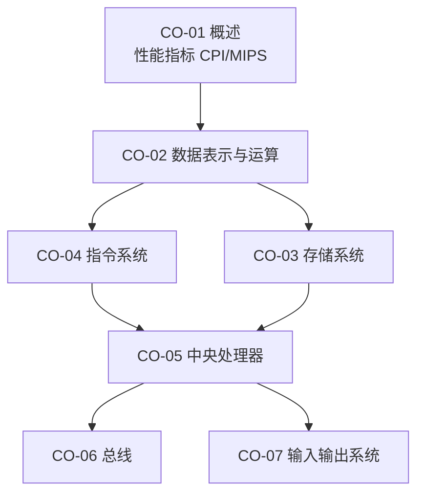

# 计算机组成原理 · 学习路线（ROADMAP）

> **本文件只回答「先学什么、学到什么程度、ROI 怎么排」，不装知识点正文。**
> 考点清单见 `syllabus/408.md` 的 `CO-01`…`CO-07`（33 个 KP 节，45 分）。
> 知识点正文：`co/<章>-<节>-<名>.md`，学到哪节建哪个文件。
>
> **现状（2026-10-28）：0 / 33 个 KP 节落盘。** 408 四个子科里唯一完全空的一个，
> 与数据结构并列 45 分，却是唯一没有任何路线文档的——本文件就是为了补这个洞。

---

## 一、这科在考什么（一句话）

**组成原理 = 一条指令从取到执行完，中间经过的每一个硬件部件，以及它们的时序与代价。**
所有题目最终都在问三件事之一：数据放在哪、怎么流过去、代价多少（周期/时间/空间）。

与另外三科的关系（避免学重）：

| 边界 | 属于组成 | 属于对方 |
|---|---|---|
| 虚拟存储器 | 地址转换机制、TLB 硬件、页表结构（`CO-0306`） | 置换算法、抖动、工作集（`OS-0302`） |
| 磁盘 | 柱面/磁道/扇区、容量与平均存取时间（`CO-0304`） | 调度算法与移动距离手算（`OS-0403`） |
| 中断与异常 | 响应时机、中断隐指令、断点现场（`CO-0505`） | 中断处理流程与特权级（`OS-0103`） |
| I/O 方式 | 接口寄存器、DMA 控制器（`CO-0704`） | I/O 软件层次、缓冲、SPOOLing（`OS-05`） |
| 校验码 | 海明/CRC 的编码与纠错原理（`CO-0203`） | 链路层帧的检错用法（`NET-0302`） |

---

## 二、章节依赖（先修关系）

- **`CO-02` 是硬前置**：补码、IEEE 754、溢出判据不清楚，`CO-03` 的地址划分和 `CO-05` 的运算器都读不下去。
- **`CO-05` 是枢纽**：数据通路 + 流水线是综合大题的主战场，它同时依赖 `CO-02`（运算）与 `CO-03`（访存）。
- `CO-06` / `CO-07` 相对独立，可以晚做、可以只做选择题深度。

---

## 三、块划分与优先级

| 块 | KP | 内容 | 优先级 | 判断依据 |
|---|---|---|---|---|
| 块1 | `CO-01` | 概述与性能指标 | ☆常规 | 选择题 1 道；但 CPI/加速比计算是后面所有"代价"讨论的度量工具 |
| 块2 | `CO-02` | 数据表示与运算（含浮点、校验码） | ★核心 | 补码/浮点每年必考；浮点加减的对阶-规格化-舍入是标准计算题 |
| 块3 | `CO-03` | 存储系统（主存扩展 / Cache / 虚拟存储） | ★核心 | **Cache 是全书最高频考点**：映射方式、地址划分、命中率、写策略 |
| 块4 | `CO-04` | 指令系统（格式 / 寻址 / 汇编 / RISC） | ★核心 | 操作码扩展与寻址方式是稳定选择题；栈帧与机器级代码近年加重 |
| 块5 | `CO-05` | CPU（数据通路 / 控制器 / 流水线） | ★核心 | 综合大题重镇；流水线冒险与加速比几乎年年有 |
| 块6 | `CO-06` + `CO-07` | 总线 + I/O 方式 | ☆常规 | 选择题为主；DMA 与中断的对比是常考点 |

> **优先级依据**：分值权重（`LEARNING.md` §五）+ 该考点需要"动笔算"的程度。
> 不做"近十年考了几次"的统计——没有可靠数据就不写。

---

## 四、建议顺序（含理由）

1. **`CO-01-03` 性能指标** → 半小时，先拿到"CPI × 周期 = 时间"这把尺子，后面每次讨论代价都用它。
2. **`CO-02` 全章** → 补码与 IEEE 754 必须一次做完、必须手算到边界值（最大/最小/非规格化）。
3. **`CO-03-05` Cache** → 直接上最高频的一块：先手画三种映射的地址划分，再做命中率与平均访问时间。
4. **`CO-03-02/0303` 主存与扩展** → 芯片扩展与地址译码是画图题，与 Cache 共用"地址切分"的思维。
5. **`CO-04` 全章** → 指令格式与寻址；`0403` 机器级代码建议与 `CO-05-02` 指令执行过程连着做。
6. **`CO-05-01`…`0505`** → 数据通路的顺序是"单周期 → 多周期 → 控制器 → 异常中断"。
7. **`CO-05-06` 流水线** → 单独一块，先把"冒险"三类分清，再算加速比与吞吐率。
8. **`CO-06` / `CO-07`** → 选择题深度，DMA 与中断对比表背下来即可。

> `CO-03-06` 虚拟存储器建议**在 OS 的内存管理之后**做（或同时做），
> 因为地址转换的"策略侧"在 `OS-0301/0302`，先有策略再回看硬件实现更省力。

---

## 五、命题形式（据真题结构推断，非大纲原文）

| 形式 | 常见落点 |
|---|---|
| 选择题 | 补码范围与溢出、IEEE 754 位段、校验码、寻址方式、指令格式合法性、CISC/RISC、总线带宽、中断与 DMA |
| 综合应用题 | **Cache 与主存**（地址划分 + 命中率 + 写策略）、**数据通路与控制器**（补信号、写微操作）、**流水线**（画时空图、算加速比、判冒险）、**指令格式与机器码**（操作码扩展、汇编翻译） |

**必须能手画的三张图**（考场画法见 `TOOLKIT.md`）：
① Cache 的三种映射地址划分；② 单周期数据通路；③ 流水线时空图。

---

## 六、ROI 排序（8 周内只做这些）

| 序 | 内容 | 产出 | 为什么排这里 |
|---|---|---|---|
| 1 | `CO-03-05` Cache | 三种映射的地址划分表 + 命中率算例 | 单点分值最高、题型最固定 |
| 2 | `CO-02-0206/0207` 浮点 | IEEE 754 位段表 + 浮点加减五步模板 | 计算题，出错即全错，必须练到机械 |
| 3 | `CO-05-06` 流水线 | 时空图 + 加速比公式 + 三类冒险判据 | 综合大题高频，模板化程度高 |
| 4 | `CO-02-0201/0204` 补码与溢出 | 表示范围表 + 三种溢出判据 | 一切运算的地基 |
| 5 | `CO-05-02/0503` 指令执行与数据通路 | 微操作序列表 | 综合大题的另一半 |
| 6 | `CO-04-0401/0402` 指令格式与寻址 | 操作码扩展的条数计算 | 稳定选择题 |
| 7 | `CO-07-0704` I/O 方式 | 三种方式对比表 | 选择题速成 |

**明确不做（冲刺期）**：`CO-01-01` 发展历程、`CO-05-07` 多处理器细节、`CO-07-0202` 外部设备细节
——只到"知道是什么"（C 了解）层次。

---

## 七、与工程线的关系

`projects/csapp.md`（archlab / datalab）与 `projects/nand2tetris.md`（ch5 整机）确实覆盖数据通路与位运算，
但那是**兴趣线，不占考试时间**。需要建立直觉时，按单向引用规则去查对应 KP，不反过来把考试学习挂到项目上。
