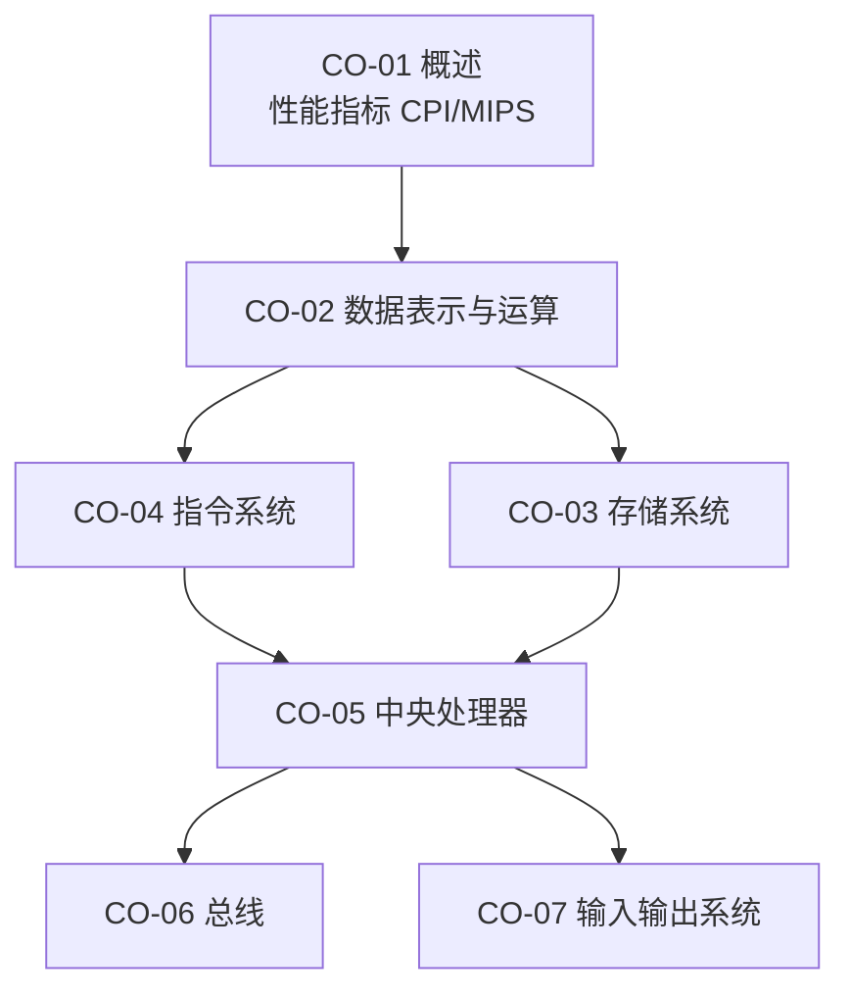

# 计算机组成原理 · 学习路线（ROADMAP）

> **本文件只回答「先学什么、学到什么程度、ROI 怎么排」，不装知识点正文。**
> 考点清单见 `syllabus/408.md` 的 `CO-01`…`CO-07`（33 个 KP 节）；**应试分层与边缘考点见 `syllabus/tiers.md`**。
> 知识点正文：`co/<章>-<节>-<名>.md`，学到哪节建哪个文件。
>
> **现状（2026-10-28）：0 / 33 个 KP 节落盘。** 408 四个子科里唯一完全空的一个，
> 与数据结构并列 45 分，却是唯一没有路线文档的——本文件就是为了补这个洞。

---

## 一、这科在考什么

**组成原理 = 一条指令从取到执行完，中间经过的每一个硬件部件，以及它们的时序与代价。**
所有题目最终都在问三件事之一：数据放在哪、怎么流过去、代价多少（周期 / 时间 / 空间）。

### 1.1 分数构成（决定「哪里拿 60、哪里拿 80」）

组成在 408 里占 **45 分**，分布是：

| 位置 | 分值 | 内容 | 性质 |
|---|---|---|---|
| 单选 **11–22 题** | **24** | 12 道，覆盖 7 章 | 覆盖面抽样，单点 2 分 |
| 综合 **43 题** | **8** | 主存扩展 / 地址划分 / 虚拟地址 | 有固定套路 |
| 综合 **44 题** | **13** | 数据通路 / 流水线 / 指令与机器码 | **全卷最难的一题** |

**结论**：
- **24 分的单选决定能不能及格**——它是均匀抽样，7 章都得过一遍，不能只挑 Cache。
- **21 分的大题决定能不能上 80**——43 是套路题（8 分应当全拿），44 是能力题（13 分里拿 6–8 分就够）。
- 44 题的读题语言是**门与元件**，见 §三。不懂那套符号，题目都读不通。

### 1.2 与另外三科的边界（避免学重）

| 边界 | 属于组成 | 属于对方 |
|---|---|---|
| 虚拟存储器 | 地址转换机制、TLB 硬件、页表结构（`CO-0306`） | 置换算法、抖动、工作集（`OS-0302`） |
| 磁盘 | 柱面/磁道/扇区、容量与平均存取时间（`CO-0304`） | 调度算法与移动距离手算（`OS-0403`） |
| 中断与异常 | 响应时机、中断隐指令、断点现场（`CO-0505`） | 中断处理流程与特权级（`OS-0103`） |
| I/O 方式 | 接口寄存器、DMA 控制器（`CO-0704`） | I/O 软件层次、缓冲、SPOOLing（`OS-05`） |
| 校验码 | 海明 / CRC 的编码与纠错原理（`CO-0203`） | 链路层帧的检错用法（`NET-0302`） |

---

## 二、章节依赖（先修关系）

- **`CO-02` 是硬前置**：补码、IEEE 754、溢出判据不清楚，`CO-03` 的地址划分和 `CO-05` 的运算器都读不下去。
- **`CO-05` 是枢纽**：数据通路 + 流水线是 44 题的主战场，它同时依赖 `CO-02`（运算）与 `CO-03`（访存）。
- `CO-06` / `CO-07` 相对独立，可以晚做、可以只做选择题深度。

---

## 三、元件级：门与触发器（44 题的语言）

> **这不是超纲。** 2022 版大纲第二章写着「（四）运算方法和运算电路：基本运算部件（加法器、ALU）、
> 减法运算（补码加减运算器、标志位的生成）、乘除电路的基本结构」。
> 2023 年真题直接考了「下列哪些是组合逻辑元件」，以及「五段流水线加旁路后哪条指令仍阻塞」。
> 完整清单与真题出处见 `syllabus/tiers.md` §4.1。

**六个必须认得、画得出、说得出控制信号的元件**：

| 元件 | 类型 | 记忆钩子 |
|---|---|---|
| 三态门 | 组合 | 1 bit 控制通断；`PCout` / `MARin` 这类信号就是它；管脚「平头进、尖头出」 |
| 多路选择器 MUX | 组合 | 控制位数 $=\lceil\log_2(\text{输入数})\rceil$ |
| 译码器 | 组合 | 3-8 译码器；地址译码 / 片选；输入少、输出多 |
| 加法器 / ALU | 组合 | `sub` 位不改输出值，改**标志位生成**：$CF=$ 最高位进位 $\oplus\,sub$ |
| 触发器 / 寄存器 | **时序** | 时钟沿写入；输出依赖历史状态 |
| 暂存寄存器 | 时序 | 单总线结构下 ALU 两个操作数之一必须先入暂存 |

**一条判别法则**（2023 单选原题考法）：
> 输出只是当前输入的函数、无记忆 ⇒ **组合**（ALU、MUX、译码器、编码器、移位器、比较器）；
> 输出与历史状态有关、有记忆 ⇒ **时序**（PC、寄存器、存储器、触发器）。

**学这一节的方式**：不写 Verilog、不做实验，只做两件事 ——
① 把 44 题历年真题的数据通路图找出来，逐个标注上面六类元件；
② 自己能画一张**单总线数据通路**，说清每条微操作需要哪几个控制信号同时有效。

**工期 2–3 小时。收益：44 题从"读不懂"变成"能拿步骤分"。**

---

## 四、块划分与分层

> 分层口径见 `syllabus/tiers.md`（T1 = 及格基础 / T2 = 优秀 / T3 = 冲刺满分）。

| 块 | KP | 内容 | 档 | 判断依据 |
|---|---|---|---|---|
| 块1 | `CO-01` | 概述与性能指标 | **T1** | 单选 2 分必考；CPI/加速比是后面所有"代价"的度量工具 |
| 块2 | `CO-02` | 数据表示与运算（补码 / IEEE 754 / 溢出 / 校验码） | **T1** | 单选每年 2–3 道；浮点加减是标准计算题 |
| 块2′ | `CO-02-0205` | 乘除电路、ALU 结构与标志位生成 | **T3** | 低频，但是 44 题的语言（见 §三） |
| 块3 | `CO-03` | 存储系统（主存扩展 / Cache / 虚拟存储） | **T1+T2** | Cache 映射属 T1（单选必考），命中率与写策略属 T2（43 题） |
| 块4 | `CO-04` | 指令系统（格式 / 寻址 / 对齐与大小端 / 机器级代码） | **T1+T2** | 格式与寻址 T1；机器级代码 T2（44 题会出） |
| 块5 | `CO-05` | CPU（数据通路 / 控制器 / 异常中断 / 流水线） | **T2** | 44 题的绝大部分；数据通路必做，微程序到 T3 |
| 块6 | `CO-06`+`CO-07` | 总线 + I/O 方式 | **T1** | 选择题为主；总线传输时间与 DMA/中断对比是稳定考点 |

**可以推到最后**：`CO-01-01` 发展历程、`CO-05-07` 多处理器细节、`CO-07-02` 外部设备细节、
`CO-05-04` 微指令编码方式（只在考微程序时才有用）。

---

## 五、建议顺序

1. **`CO-01-03` 性能指标** → 半小时，先拿到「CPI × 周期 = 时间」这把尺子。
2. **`CO-02-0201` 补码 + `0204` 溢出** → 一切运算的地基，手算到边界值。
3. **`CO-02-0206/0207` IEEE 754 与浮点加减** → 五步模板练到机械：对阶 → 尾数运算 → 规格化 → 舍入 → 溢出判断。
4. **`CO-03-05` Cache** → 直接上最高频的一块：先手画三种映射的地址划分，再算命中率与平均访问时间。
5. **`CO-03-02/0303` 主存与扩展** → 芯片扩展与地址译码是画图题，与 Cache 共用"地址切分"的思维。
6. **`CO-04` 全章** → 指令格式与寻址；`0403` 机器级代码建议与 `CO-05-02` 连着做。
7. **`CO-05-01`…`0505`** → 单周期 → 多周期 → 控制器 → 异常中断；**中间穿插 §三 的元件级**。
8. **`CO-05-06` 流水线** → 单独一块：先分清三类冒险，再算加速比与吞吐率。
9. **`CO-06` / `CO-07`** → 选择题深度，DMA 与中断对比表背下来即可。

> `CO-03-06` 虚拟存储器建议**在 OS 内存管理之后**做（或同时做）：
> 策略侧在 `OS-0301/0302`，先有策略再回看硬件实现更省力。

---

## 六、44 题的专用准备（数据通路 / 流水线，13 分）

44 题是全卷最难一题，但**题型可穷举**，历年基本在这四类里：

| 题型 | 常问 | 准备动作 |
|---|---|---|
| 补全数据通路 | 填控制信号、连线、写微操作序列 | §三 的六元件 + 一张手画的单总线图 |
| 指令格式与机器码 | 操作码扩展、汇编 ↔ 机器码、寻址方式 | `CO-04-0401/0402` + 相对寻址目标计算 |
| 流水线 | 画时空图、判冒险、算阻塞周期与加速比 | `CO-05-06` + CSAPP 第 4 章的转发源表 |
| 异常 / 中断 | 响应时机、断点保存、中断隐指令 | `CO-05-05` |

**CSAPP 第 4 章（Y86-64）在这里的用处**：408 只给"五段流水线有三类冒险"这个结论，
CSAPP 给的是**值在哪一级可用**（`e_valE` / `M_valE` / `m_valM` / `W_valE` / `W_valM`）——
这正是"两条指令之间要不要停、停几拍"的判据。读法：只读 §4.1、§4.3、§4.4 前半，
跳过 HCL 与实验，约 4–5 小时。实现（archlab）在 `projects/csapp/NOTES.md`，**不占考试时间**。

---

## 七、命题形式

| 形式 | 常见落点 |
|---|---|
| 选择题 | 补码范围与溢出、IEEE 754 位段（含非规格化）、校验码、寻址方式、指令格式合法性、**对齐与大小端**、CISC/RISC、总线带宽、中断与 DMA、**组合 / 时序元件判别** |
| 综合应用题 | **Cache 与主存**（地址划分 + 命中率 + 写策略）、**数据通路与控制器**（补信号、写微操作）、**流水线**（时空图 / 加速比 / 冒险）、**指令格式与机器码** |

**必须能手画的四张图**（考场画法见 `TOOLKIT.md`）：
① Cache 三种映射的地址划分；② 单总线数据通路；③ 流水线时空图；④ 主存芯片扩展连线。

---

## 八、ROI 排序（8 周内只做这些）

| 序 | 内容 | 档 | 产出 | 为什么排这里 |
|---|---|---|---|---|
| 1 | `CO-03-05` Cache | T1+T2 | 三种映射地址划分表 + 命中率算例 | 单点分值最高、题型最固定 |
| 2 | `CO-02-0206/0207` 浮点 | T1 | IEEE 754 位段表 + 浮点加减五步模板 | 计算题，错一步全错 |
| 3 | `CO-05-06` 流水线 | T2 | 时空图 + 三类冒险判据 + 加速比 | 44 题高频，模板化程度高 |
| 4 | `CO-02-0201/0204` 补码与溢出 | T1 | 表示范围表 + 三种溢出判据 | 一切运算的地基 |
| 5 | `CO-05-02/0503` 指令执行与数据通路 | T2 | 微操作序列表 + 控制信号表 | 44 题的另一半 |
| 6 | `CO-04-0401/0402` 指令格式与寻址 | T1 | 操作码扩展条数计算 | 稳定选择题 |
| 7 | **§三 元件级** | T3→T2 | 六元件表 + 一张手画数据通路 | **2 小时换 44 题读得懂**，性价比最高 |
| 8 | `CO-07-0704` I/O 方式 | T1 | 三种方式对比表 | 选择题速成 |

**明确放弃（写在纸上，避免反复摇摆）**：`CO-01-01` 发展历程、`CO-07-02` 外部设备细节、
`CO-05-07` 多处理器（只到"知道有 SIMD/SMP"）、`CO-05-04` 微指令编码方式（除非真题明确考）。

---

## 九、与工程线的关系

`projects/csapp/NOTES.md`（archlab / datalab）与 `projects/nand2tetris/NOTES.md`（ch5 整机）覆盖了数据通路与位运算，
但那是**兴趣线，不占考试时间**。需要建立直觉时，按单向引用规则去查对应 KP，
不反过来把考试学习挂到项目上。
