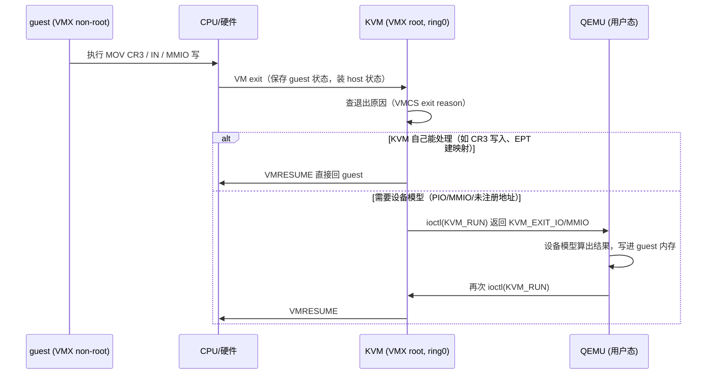

# virtualization · 分章详细

> 十章，每章四段：**要解决的问题 / 机制 / 最小例子 / 面试高频问法**。
> **数字口径**：凡是量级数字都标了"量级"，且给出测法与出处；**没有实测就不要背别人的数字**（第 10 章给了最小实验集）。
> **边界**：讲机制与成本，不给逃逸利用步骤、不给平台调优参数大全；实验限定在自己搭的 guest / 自己写的 VMM 里。
> **与兄弟项目的关系**：页表与陷入在 `../jos/`，三家内核的形状在 `../kernel-compare/`，设备驱动四步在 `../drivers/`，
> 性能方法论在 `../../eng/perf-engineering/`。这里不重复，只讲"多出来的一层"。

---

## 第 1 章 边界：一台机器有哪些"可以被截走"的东西

**要解决的问题**：虚拟化不是"装个软件"，而是**把一台机器上原本独占、不可共享的资源，变成可以多个世界轮流使用的资源**。
先得把"一台机器"拆成清单，才知道每一样要交给谁、代价多少、漏了哪一样会出事。

**机制**：一张清单 + 一条定理 + 一段历史。

| 资源 | 独占时的形态 | 虚拟化后由谁仲裁 | 漏掉的后果 |
|---|---|---|---|
| CPU 执行状态 | 一组寄存器 + 特权级 | CPU（世界切换）+ 保存/恢复 | 切回来时上下文错乱，随机崩 |
| 地址空间 | `CR3` 指向的一棵页表 | 二级页表（EPT/NPT） | guest 能碰宿主内存 |
| 中断与异常 | 本地 APIC + IDT | 虚拟中断控制器（APICv/vGIC） | 中断投错世界，或中断风暴 |
| 设备寄存器 | 物理地址/端口上的一小段 | 设备模型（trap）或硬件分区 | 两个 guest 抢同一个设备 |
| DMA | 设备直接写物理内存 | IOMMU 重映射 | 设备可写任意物理页（等于没有隔离） |
| 时间 | TSC / HPET / 时钟中断 | 半虚拟化时钟（`kvm-clock`）、TSC offset | 计时器漂移、`sleep` 不准 |
| 特权配置 | `CR0/CR4/EFER/MSR` | VMCS 中按位拦截 | guest 改了宿主的关键位 |

**Popek & Goldberg（1974）三条件**（虚拟机要"看起来像真机"必须同时满足）：

1. **等价（equivalence）**：guest 里跑的程序，行为与在真机上相同（时间与资源可用量除外）。
2. **性能（performance）**：绝大多数指令**直接在硬件上执行**，不经过 VMM。
3. **资源控制（resource control）**：VMM 完全掌握系统资源，guest 不能绕过它。

第 2 条是全部工程难度的来源：**"绝大多数直接跑"意味着只能对少数指令做拦截，而哪些指令必须拦，是硬件说了算的。**

**敏感指令的四种身份**（这是理解 x86 历史的关键）：

| 类别 | 定义 | 例子 | 处理方式 |
|---|---|---|---|
| 特权指令 | 在非最高特权级执行就 `#GP` | `MOV CR3`、`HLT`、`IN`/`OUT`（受 `IOPL` 约束）、`LGDT` | 天然可拦：陷出 → 模拟 |
| 控制敏感 | 不改特权级就能改特权状态 | `MOV CR3`（也是特权） | 同上 |
| **行为敏感** | **不陷出，但行为与真机不同** | `SGDT`/`SIDT`/`SLDT`/`STR`（读到的是**宿主**的描述符表基址）、`POPF`（`CPL>IOPL` 时**静默忽略** `IF` 的修改）、`SMSW` | **拦不住 → 只能翻译或改客户机内核** |
| 无害 | 既不敏感也不特权 | `ADD`、`JMP` | 直接跑 |

**定理的实用形式**：`trap-and-emulate` 可行的充要条件是 **敏感指令 ⊆ 特权指令**。
x86 违反这一条——它有一批"行为敏感但不特权"的指令（常见普查列出十几条，不同来源口径略有出入）。
后果非常具体：客户机内核以为自己 `cli` 关了中断，其实 `POPF` 被静默忽略，中断还开着，于是**临界区被真实中断打断**，
表现为随机的数据错乱与时钟漂移——**不报错，只是错**。这比崩溃难查一个数量级，所以它逼出了两条替代路线：

- **二进制翻译**（VMware 的早期方案）：在**运行前**扫描基本块，把行为敏感指令替换成对 VMM 的调用。
- **半虚拟化**（Xen）：直接**改客户机内核**，把敏感指令换成 `hypercall`（这也是 Linux 里 `pv_ops` 的由来）。

**ring compression**：既然客户机内核不能待在 ring0（否则它真的能改宿主状态），VMware 把它降到 **ring1**，VMM 占 ring0，用户态仍在 ring3。
代价是"privilege 检查靠 `CPL==0`"的指令会被拦下（好），"检查 `CPL<=IOPL`"的指令不会（坏，正是 `POPF`）。
这个不对称就是"敏感但非特权"在真实 CPU 上的物理来源。

**最小例子**：guest 内核执行 `sti`/`cli`（编译成带 `IF` 位的 `POPF`）。
在 ring1、`IOPL=0` 时，`POPF` **不陷出**，`IF` 位被丢弃 —— 客户机以为中断已关闭，继续改一个链表；
宿主时钟中断照样打进来，VMM 的中断处理看到"链表正在被改"，于是崩在客户机根本没写过的地址上。
**判据：能指着一条具体指令说出"它属于上表哪一类、在没有 VT 的时代靠什么手段补救、代价是每次都要付还是只付一次"。**

**面试高频问法**：

1. **「为什么 x86 早期不能虚拟化，ARM 却可以？」** → 考点：敏感指令与特权指令的包含关系。
   → 答法：x86 有一批"读了不陷出"的指令（`SGDT`/`SIDT`/`POPF`），在 ring1 上静默做错事，`trap-and-emulate` 的充要条件不成立，只能翻译或改内核；ARM 从一开始就把敏感状态集中在协处理器与 `HCR_EL2` 里，非 EL2 访问必然陷入，且没有分段与 ring compression 这段包袱。**判据不是"谁更快"，是"敏感 ⊆ 特权"这条是否成立。**
2. **「`trap-and-emulate` 的成本花在哪？」** → 考点：哪些操作必须陷出。
   → 答法：只花在"必须由 VMM 说话"的那一小撮操作上：特权指令、MMIO/PIO、中断注入、页表相关的旧方案。**绝大多数算术与访存不陷出**——这正是 Popek-Goldberg 第 2 条的要求，也是为什么"虚拟化的开销"不能笼统说成"慢 20%"，而要看负载里陷出操作的密度。
3. **「半虚拟化是不是过时了？」** → 考点：硬件扩展消掉了哪一部分。
   → 答法：硬件扩展（VT-x/EPT/APICv）消掉的是**CPU 与内存**那一侧的陷出，**I/O 那一侧的半虚拟化反而成了事实标准**（virtio 就是半虚拟化）。所以准确说法是：CPU 虚拟化的半虚拟化路线退场，I/O 虚拟化的半虚拟化路线胜出。判据：看 guest 里有没有驱动知道自己是虚拟机。

---

## 第 2 章 两种引擎：陷出模拟与二进制翻译

**要解决的问题**：没有硬件扩展时怎么跑？有扩展时为什么还需要"翻译"？两个引擎的判据不同，混在一起讲就会得出"TCG 是过时的 KVM"这种错误结论。

**机制**：

**(a) `trap-and-emulate` 的闭环**（有硬件扩展时的主路径）：



**关键点**：闭环里有**两处**可能"短路"。KVM 能自己处理的退出不回到用户态（这是第一层短路）；
能通过 `ioeventfd` 绑到 `eventfd` 的写操作，连 KVM 都不用回（第二层短路，见第 5、6 章）。

**(b) 二进制翻译**（无扩展、或跨架构时的唯一路径）：
读一段 guest 指令 → 识别**基本块**（到跳转/调用为止）→ 翻译成宿主指令序列 → 放进**翻译缓存**（TB）→ 执行。
三个必须解决的工程问题：

| 问题 | 做法 | 不做会怎样 |
|---|---|---|
| 下次怎么找到这块 | 用 guest PC 做键查哈希表 | 每轮都重新翻译，慢到不可用 |
| 怎么避免"翻译→跳回分发器→再翻译" | **直接块链接**：TB 末尾直接 `jmp` 到目标 TB 的宿主地址 | 每个基本块都回一次分发器，性能腰斩 |
| 客户机自己改代码怎么办 | TB 页设为只读，写触发 `SIGSEGV` → 把该页所有 TB 失效并重译 | 跑的是旧代码，程序行为错 |

QEMU 的这套叫 **TCG**（Tiny Code Generator）：每条 guest 指令展开成中间表示（TCG ops），再由后端生成宿主代码；
`-d in_asm,op,out_asm` 能把三层都打出来，这是"读懂 TCG"最快的方式（一次翻译，三份视图）。

**(c) 半虚拟化**（第三条路，只在这里点一句）：改客户机内核，把"会陷出的操作"换成显式的 `hypercall`。
它的优势是**不用假装**——客户机知道自己被虚拟化，于是可以把"批处理""通知抑制"这类优化直接写进驱动（virtio 就是这么来的）。
劣势是**要改内核 / 要有驱动**，所以它成了 I/O 的标准形态、CPU 的非标准形态。

**为什么 KVM 不能跨架构**：KVM 的全部工作是"把 guest 的指令流**原样**交给物理 CPU 执行"，它不翻译任何东西。
所以 `qemu-system-x86_64` 在没有 x86 硬件虚拟化的宿主上（例如 Apple Silicon 跑 x86 镜像）只能退回 TCG。
**量与质的差别在这里**：KVM 的每次拦截是"硬件举手"，纳秒级；TCG 的每条指令都要经过翻译过的代码，且翻译块本身占 cache。
实测差异常在**一到两个数量级**（启动一个发行版：KVM 秒级、TCG 分钟级），具体数字自己测（第 10 章实验 ①）。

**最小例子**：在 Apple Silicon 上 `qemu-system-x86_64`（无 KVM、纯 TCG）启动一个最小 Linux，
与在同架构机器上用 `-accel kvm` / `-accel hvf` 启动同一镜像对比"到串口出现 `login:`"的时间。
判据：能说出差的这一到两个数量级里，**多少来自翻译开销、多少来自 TB 未命中后的重译、多少来自设备模型**（用 `-d tb_stats` 或 QEMU 的 `-trace` 分开看）。

**面试高频问法**：

1. **「TCG 和 KVM 是不是一回事的两种实现？」** → 考点：一次跨界的性质完全不同。
   → 答法：不是。KVM 是"让 CPU 直接跑 guest 指令，只在硬件举手时接管"，代价是**每次退出**；TCG 是"把 guest 指令改写成宿主指令再跑"，代价是**每条指令都多一层翻译 + 缓存压力**。前者要求同架构且有扩展，后者可跨架构。判据：`qemu-system-<arch>` 的 `-accel` 里有没有 `kvm`。
2. **「自修改代码（JIT、动态链接器）在 TCG 下怎么处理？」** → 考点：翻译缓存的失效。
   → 答法：把存放翻译块的客户机页设成只读，guest 写触发段错误，QEMU 在该页的 TB 全部作废、重译并恢复可写。代价是**写代码页比写数据页贵得多**，所以 TCG 下 JIT 密集的负载（浏览器、JVM）会明显更慢。
3. **「虚拟化开销到底是 5% 还是 50%？」** → 考点：负载决定陷出密度。
   → 答法：这个数没有意义，除非说清负载。CPU 纯计算（陷出密度≈0）可以接近裸机；小包网络 + 每次包一次退出可以慢数倍；`fork` 密集 + 全模拟设备会更惨。**正确答法是给出本负载的 `vmexit/s` 与单次退出的乘积，而不是一个百分比。**

---

## 第 3 章 硬件辅助：把控制权交给 CPU

**要解决的问题**：把"什么时候必须由 VMM 接管"从**软件扫描**变成**硬件判定**，并且让"接管"这件事本身有一个统一的状态容器。

**机制**：

**(a) 两个世界 + 一个状态容器。**
VT-x 把 CPU 分成 **VMX root**（宿主/VMM，ring0 仍是 ring0）与 **VMX non-root**（guest，它的 ring0 只是 non-root 的 ring0）。
世界的切换由 `VMLAUNCH`（首次）/`VMRESUME`（后续）与 `VM exit` 完成，一次切换要保存/恢复的状态全在 **VMCS** 里：

| VMCS 字段组 | 存什么 | 为什么要它 |
|---|---|---|
| guest-state | guest 的 `RIP/RSP/RFLAGS`、`CR0/3/4`、段寄存器、`MSR` 区 | 退出时"把世界定格"，加入时"照原样装回去" |
| host-state | 宿主的 `CR3`、`RSP`、`RIP`（退出处理入口）、段选择子 | 退出后立刻能跑宿主代码，不用查表 |
| VM-execution controls | **拦截位图**：哪些指令/异常/MSR 访问要退出 | 这就是"哪些操作收税"的开关 |
| VM-exit / entry controls | 退出时要不要存某些字段、注入什么事件 | 决定单次退出的成本 |
| exit information | 退出原因（basic reason）+ 附加信息（如端口号、地址） | 决定 KVM 走哪条处理分支 |

**核心洞察**：**虚拟化的性能 ≈ 拦截位图的疏密 × 单次退出的成本。**
所以硬件厂商做的事就是"把位图上的位一个个关掉"：`CR3` 读写不退出（VPID + CR3 target）、
不关心的 `MSR` 不退出（MSR bitmap）、`HLT`/`PAUSE` 可配（PAUSE-loop exiting）、
`EPT` 让页表写入根本不需要退出、`APICv` 让中断写入虚拟 APIC 页不退出。

**(b) 单次退出的成本构成**（这是全篇最重要的量）：

| 部分 | 内容 | 量级 |
|---|---|---|
| 固定：状态切换 | 存 guest 状态、装 host 状态、换栈、换页表基址 | 数十到上百周期 |
| 固定：流水线与缓存污染 | 分支预测器被另一套代码搅乱、TLB 与 cache 部分失效 | 与工作集相关，常是主要项 |
| 可变：软件处理 | KVM 分支 + 设备模型（可能回到用户态、可能 `malloc`） | 从几十周期到微秒级不等 |
| 安全缓解 | `L1D` flush（L1TF）、`VERW`（MDS）、IBRS 等 | **可能把固定部分翻几倍** |

合计常在**数百到上千周期**（几十到几百纳秒）——比一次函数调用贵两个数量级以上。
**这就是为什么"一次退出搬 4KB 划算、搬 1 字节是灾难"**，也是为什么 4KB 以上的 I/O 都走共享内存环而不是寄存器。

**(c) 让中断也不退出**：`APICv` 把虚拟 APIC 的寄存器页直接映射进 guest（写它不退出），
`posted interrupt` 允许一个 CPU 核把中断"投递"到另一个核上的 vCPU 而**不惊动**目标核的 VMM——
这对多核网络负载是决定性的（否则每个包一次 IPI + 一次退出）。

**(d) ARM 的做法**：`EL0/EL1` 是用户态/内核态，**`EL2` 是 hypervisor**，`EL3` 是安全监控。
`HCR_EL2` 是"拦截位图"的等价物（`IMO`/`FMO`/`AMO` 把物理中断、FIQ、SError 路由到 EL2），
`VTTBR_EL2` 指向 stage-2 页表（等价 EPT），`GIC` 的虚拟 CPU 接口（`ICH_*` 寄存器）做中断注入，
**VHE**（Virtualization Host Extensions）让宿主内核自己跑在 EL2，省掉一次世界切换。
ARM 干净的原因很直接：**没有分段、没有 ring compression、敏感状态集中、设计时就考虑了虚拟化**。

**(e) 嵌套虚拟化为什么贵**：guest 里再跑一个 hypervisor，L2 的每次退出都要先到 L1 的 hypervisor，
L1 还要判断"这个退出是给我的还是给 L0 的"。`VMCS shadowing` 缓解了 `VMREAD/VMWRITE` 的退出，
但**退出次数是乘法的**——L2 的一次 I/O 可能变成 L0 + L1 两轮处理。

**(f) 机密计算：把边界再往下挪一层。** `SEV-SNP`/`TDX` 把 guest 内存加密，
于是 **hypervisor 自己也不在信任边界内**（云厂商看不到你的内存）。
代价很实在：内存不能随便 balloon/KSM（加密页不能合并）、迁移受限、DMA 要 bounce buffer 或 Trusted IO。
这一条是"安全 ↔ 性能"张力的最新形态：**上一代为了隔离引入了退出，这一代为了隔离要放弃退出路径上的所有优化。**

**最小例子**：guest 执行 `HLT`（空闲循环）。
`HLT` 是特权指令 → 在 non-root 下必然退出 → `KVM_EXIT_HLT` → QEMU 把该 vCPU 线程阻塞在 `eventfd` 上
→ **这个 vCPU 不再占 CPU**，直到有中断（定时器/网卡）到来才被唤醒并 `VMRESUME`。
判据：能解释"为什么一台空闲的 VM 宿主 CPU 占用接近 0"，以及"为什么 `while(1);`（不 `HLT`）的 guest 会烧满一个核"——
因为后者没有退出、没有阻塞，就是纯粹的硬件执行。

**面试高频问法**：

1. **「VM exit 到底做了什么，为什么这么贵？」** → 考点：状态切换 + 污染。
   → 答法：把 guest 的寄存器/控制状态存进 VMCS、装上 host 的 `CR3/RSP/RIP`、跳到退出处理入口；回来时反过来。贵在三处：**寄存器与 MSR 的批量存取**、**cache/分支预测/TLB 被另一套代码污染**、以及**安全缓解（`L1D` flush 等）把这个固定成本放大**。所以判据永远是"退出次数 × 单次成本 × 每次搬多少数据"。
2. **「为什么要 `VPID`？没有它会怎样？」** → 考点：TLB 与世界的对应。
   → 答法：没有 `VPID`，每次进出 guest 都要刷 TLB（因为同一个 `CR3` 值可能对应不同地址空间）；有了 `VPID`，TLB 项带上"属于哪个世界"的标签，进出不用刷。ARM 的等价物是 `ASID`。**这是"减少退出"之外的第二类优化：退出还是要退出，但退出之后不用重建缓存状态。**
3. **「EPT 有了，为什么还要大页？」** → 考点：走表次数与 TLB 容量。
   → 答法：EPT 把"每次页表写入都退出"消掉了，但**每次 TLB 未命中要走的表变多了**（二维走表），而 TLB 表项数没变。2MB 大页一次顶 512 个 4KB 项，既减少走表层数也提高 TLB 覆盖范围——虚拟化下收益比裸机更大。**代价**：宿主长时间运行后 2MB 连续页难分配，EPT 大页会"塌陷"，性能退化而指标上看不出来（这是第 10 章的归因陷阱之一）。

---

## 第 4 章 内存虚拟化：从影子页表到二维走表

**要解决的问题**：guest 里的虚拟地址要经过**两次**翻译才对得上物理内存，而 guest 自己以为只有一次。谁来做第二级、在什么时候做，决定了整个系统的性能与功能（迁移、快照、超分都挂在这一层）。

**机制**：

**(a) 地址的三段与两跳**：

```
guest 虚拟地址 (GVA) --[guest 页表, CR3/EPTP 之一]--> guest 物理地址 (GPA) --[EPT/NPT, 宿主页表]--> 宿主物理地址 (HPA)
```

**(b) 第一代：影子页表（shadow page table）**
VMM 维护一份**把 GVA 直接映射到 HPA** 的页表交给硬件，硬件只走一跳。

| 环节 | 做法 | 代价 |
|---|---|---|
| 建立 | 拦截 guest 对页表的每次写（把 guest 页表页设为只读） | 每次建/改 PTE 都退出一次 |
| 同步 | 退出后读 guest PTE 的内容，把影子表项补上 | 退出 + 软件走表 |
| 失效 | guest 换 `CR3` 或 `INVLPG` 都要同步 | `fork`/`exec`/缺页密集负载灾难性变慢 |
| TLB | guest 以为在刷自己的 TLB，实际刷的是影子的 | 无法与 guest 共享 TLB |

**判据**：进程创建、`mmap` 大区域、数据库 buffer pool 冷启动——**这些负载的退出次数与页表操作数成正比**，所以影子页表在老虚拟化上最痛。

**(c) 第二代：EPT / NPT（硬件二维走表）**
硬件**同时**走 guest 页表与 EPT，guest 写自己的页表**不再退出**。代价从"每次写页表退出"变成"每次 TLB 未命中多走几级表"：

- 4 级 guest + 4 级 EPT，最坏情况下一次访存要**二十次上下**的内存访问（每读一个 guest 页表项，都要先经 EPT 把它的 GPA 翻成 HPA）；
- 实际绝大多数被 TLB + 页表缓存（paging-structure cache）挡住，所以**命中率决定一切**。

**EPT violation 的三种用途**（这是"故障即功能"的范例）：

| 触发场景 | KVM 的反应 | 对上层的意义 |
|---|---|---|
| GPA 没有对应内存槽（如访问 APIC、UART、PCI BAR） | 查内核内 `io_bus`；查不到就 `KVM_EXIT_MMIO` 交给 QEMU | **MMIO 就是这样被拦下来的** |
| 迁移期间该页被写保护 | 记录脏页、恢复可写 | 脏页跟踪（增量迁移的基础） |
| HPA 未分配/被宿主换出 | 宿主分配或换入，重建 EPT 项 | 内存超分能工作的前提 |

补一句容易被忽略的：`EPT` 的 **A/D 位**（Accessed/Dirty）若不做硬件维护（`EPT_AD` 关闭），
脏页跟踪就只能靠"写保护 + 每次写都 violation"，成本高一个量级——这是第 7 章迁移性能的直接前提。

**(d) TLB 那一侧**：`VPID`/`ASID`（世界标签）、大页（2MB/1GB，减少层数）、PCID（宿主内部）。
三层叠加才有"接近裸机"的访存性能；少任何一层，随机访存大工作集会掉得很明显。

**(e) 内存的"账"：超分与回收。**

| 手段 | 机制 | 代价 / 风险 |
|---|---|---|
| overcommit | 宿主按虚拟大小分配，实际按需 | 过量时 OOM 或 swap，guest 看到的是"机器突然变慢" |
| balloon | guest 里的驱动"申请"一大块内存再交还宿主 | 需要 guest 配合；回收慢；不解决碎片 |
| KSM | 扫描 + 校验和比较，相同的页合并成一份 COW | **CPU 开销常驻**；**跨安全域的页合并是侧信道**（时间上的"你有没有这个页") |
| hugepage | 预先分配 2MB/1GB 页给 guest | 减少走表；但**不可 swap、预分配浪费**；EPT 大页会塌陷 |
| 内存热插 | ACPI 热插槽 + `-device pc-dimm` | 粒度粗（通常 GB 级），且需要 guest 支持 |

**最小例子**：guest 里 `malloc` 4KB 并首次写。
① guest 页表缺页 → ② guest 内核分配一个 GPA 页、写 PTE（**EPT 下这一步不退出**）→ ③ 硬件发现该 GPA 无 EPT 映射 → EPT violation → ④ KVM 在内存槽里找到对应的用户态 `mmap` 地址（可能还没分配物理页）→ ⑤ 宿主缺页补页 → 建 EPT 项 → ⑥ 恢复执行。
判据：能数出这 6 步里**哪几步在宿主内核、哪几步可能回到 QEMU 用户态**（答案是 ④⑤ 在内核，只有 GPA 不在任何内存槽时才回用户态）。

**面试高频问法**：

1. **「影子页表和 EPT 的本质区别？」** → 考点：谁在什么时候做第二级翻译。
   → 答法：影子是**软件提前合表**（把两跳压成一跳），代价是所有页表写都要拦；EPT 是**硬件现场走两跳**，代价是每次未命中多走几级。前者把成本放在"页表变更频率"上，后者把成本放在"TLB 未命中率"上。所以负载特征决定谁赢——**页表狂改的负载（大量 `fork`/`mmap`）影子更痛；随机访存大工作集 EPT 更痛（除非有大页）。**
2. **「VMware 的内存超分怎么做的，为什么 KSM 有安全争议？」** → 考点：去重的信息泄露。
   → 答法：balloon 让 guest 主动还、KSM 去重、再加上 swap 与 page sharing。KSM 把"内容相同的页"合并，于是**攻击者可以通过"我的页有没有被合并/写时延差异"判断别人有没有某个页**——典型的跨安全域计时侧信道；这也是机密计算环境里必须关掉 KSM 的原因。
3. **「`CR3` 里存的是 GPA 还是 HPA？」** → 考点：两跳的边界。
   → 答法：guest 眼里的 `CR3` 是 GPA（它以为那是物理地址），硬件用 `EPTP` 把 guest 页表本身再翻一次。**所以 guest 页表页也在 EPT 的保护下**——guest 改不了别人的页表，正是靠这一层。
4. **「为什么热迁移能不停机，脏页跟踪靠什么？」** → 考点：写保护 + 位图。
   → 答法：把所有 guest 页在 EPT 里标成只读，第一次写触发 violation，KVM 记一位脏页并恢复可写（`EPT_AD` 开着时用硬件 A/D 位更便宜）；迁移线程按位图迭代重传。**收敛条件是"脏页产生速度 < 传输速度"**，不满足就永远迁不完——这是第 7 章的判据。

---

## 第 5 章 I/O 虚拟化：四级台阶与它们的税

**要解决的问题**：CPU 与内存的虚拟化有硬件兜底，**设备没有**（设备种类无穷多、协议无标准）。
所以 I/O 是虚拟化里"软件味最重"的一层，也是性能差异最大的一层。

**机制**：一条从"每次访问都退出"到"几乎不退出"的谱系。**四级台阶，每级都在减少同一次 I/O 的退出次数。**

| 级 | 做法 | 一次 4KB 读的退出次数（量级） | 典型设备 | 什么时候用 |
|---|---|---|---|---|
| 0 全模拟 | 每次 PIO/MMIO 访问都退出，QEMU 逐寄存器模拟 | 几十次（寄存器逐个访问；数据阶段靠 `rep insw` 才能合并成少数几次） | 8250 串口、i8042、IDE PIO、VGA | 兼容性、老系统、调试 |
| 1 virtio | 共享内存环 + 一次通知传一批 | 1–2 次（kick + 中断） | virtio-blk/net/scsi/fs/balloon/vsock | **默认选择** |
| 2 数据面下沉 | 后端在内核（vhost-net）或另一进程（vhost-user），`ioeventfd`/`irqfd` 短路 QEMU | 0–2 次，**且不经过 QEMU 进程** | vhost-net、vhost-user（DPDK/OVS）、vhost-vdpa | 高吞吐网络、NFV |
| 3 直通 | 设备真给 guest，DMA 经 IOMMU 翻译 | 仅配置与部分中断 | VFIO-PCI、SR-IOV VF、mdev/vGPU | 低延迟、GPU、专用网卡 |

**(a) 0 级的税有多重**：一个全模拟的 IDE 控制器，一次 PIO 读要依次访问"命令寄存器、LBA 低/中/高、扇区计数、数据端口"——
每个端口一次 `KVM_EXIT_IO`。**注意这里退出次数与数据量无关**，所以它在大块 I/O 上还不至于灾难，在**小操作密集**的场景才是灾难（大量 512B 读、每次 `stat` 一次）。

**(b) 1 级 virtio 的三个机制**（面试最常被追问的一层）：

| 机制 | 结构 | 解决的问题 |
|---|---|---|
| 分离环（split ring） | 描述符表（每项 `addr/len/flags/next`）+ `avail` 环（guest 写）+ `used` 环（host 写） | **数据不跨界**：只传"索引"与"地址"，不拷贝内容 |
| 通知抑制（`EVENT_IDX`） | 双方各自声明"我需要被通知的下标" | 环里还有大批未处理项时**不必每次 kick** |
| 批处理 / 链式描述符 | 多个请求一次 kick、可选 indirect 描述符 | 把"一次退出传一个请求"变成"一次退出传一批" |

环的正确性靠两条：**单生产者单消费者**（每一侧只推进自己的索引）+ **内存屏障**（先写数据再更新索引）。
这两条错了就是"偶发的数据错乱"，属于最难查的一类 bug。

**(c) 2 级：把数据面搬出 QEMU。** 两条路，判据是"后端要不要可编程"：

- **vhost-net（内核态）**：`ioeventfd` 把 guest 的 kick 直接绑到 `eventfd`，内核里的 `vhost_worker` 线程取环、`sendmsg` 到 tap；完成后 `irqfd` 注入中断。**QEMU 主循环完全不参与数据面**，但它仍持有控制面（设备热插、迁移、错误）。
- **vhost-user（用户态）**：同样的约定，但后端是**另一个进程**（DPDK、OVS、SPDK），通过 Unix socket 交换配置、通过共享内存映射 vring。代价是**多一次跨进程唤醒**，收益是后端可以自己写（用户态协议栈、自定义转发）。**这是"性能 vs 可编程性"的直接交换**，也是 NFV 的主流形态。

**(d) 3 级：直通。** 关键不是"性能好"，而是**把隔离边界从软件挪到硬件**：

| 条件 | 作用 | 缺了会怎样 |
|---|---|---|
| IOMMU（VT-d/AMD-Vi） | 把设备的 DMA 地址也做一次翻译 | 设备可读写任意物理内存 → 直通变成大洞 |
| 中断重映射 | 中断也能被"翻译"到指定 vCPU | MSI 可被伪造，投递到宿主 |
| ACS / IOMMU group | 保证一个组内的设备不能互相绕过 | 同组设备会互相穿透，直通不安全 |
| SR-IOV | 硬件把设备切成多个 VF，各自有 BAR | 一台物理设备只能给一个 guest |

**直通的代价必须说清**：不能热迁移（设备状态在硬件里）、不能快照、数量受硬件限制、`ACS` 不满足时需要整组直通。

**(e) 旁支：文件共享为什么天生慢。** `virtio-fs` 与 9P 都把**文件系统协议**塞进 virtqueue：
一次 `stat` 在本地是一次内存操作，在这里是**一次环往返 + 一次 FUSE 请求/响应**，元数据密集的负载（`git status`、`npm install`）会被数量级地拖慢。
`virtio-fs` 的 `DAX` 窗口能让文件内容**直接映射宿主页缓存**（省掉数据拷贝），但**元数据操作仍然要往返**——这解释了 WSL2 的经典现象（见第 9 章）。

**最小例子**：同一个 4KB 随机读，四条路径的退出与拷贝次数：

| 路径 | 退出 | 数据拷贝 |
|---|---|---|
| IDE PIO 全模拟 | 十次以上（寄存器逐个访问） | 从 QEMU 缓冲区 `memcpy` 进 guest 内存 |
| virtio-blk（QEMU 用户态后端） | 1 次 kick + 1 次中断注入，**中间可能夹一次 QEMU 唤醒** | 直接写进 guest 描述符指向的内存（零拷贝） |
| virtio-blk + iothread | 同上，但 I/O 在独立线程，不占 BQL | 同上 |
| VFIO 直通 NVMe | 0（只有配置与少量中断） | **DMA 直接写 guest 内存**，CPU 全程不参与 |

判据：能说出"这条路径上 CPU 参与了几次、内存被拷了几次、进程上下文切换了几次"——**三个数就是全部性能差异的来源**。

**面试高频问法**：

1. **「virtio 是模拟设备还是真设备？」** → 考点：半虚拟化的定义。
   → 答法：是**软件设备，但 guest 知道自己是虚拟机**，所以驱动可以直接按约定的环格式工作——不需要假装成 IDE 或 e1000。这就是半虚拟化：**放弃"透明"，换"高效"**。判据：guest 里能看到 `virtio-pci` 设备与对应驱动。
2. **「vhost-user 比 vhost-net 强在哪，代价是什么？」** → 考点：数据面位置。
   → 答法：强在后端可编程（DPDK/OVS/自定义协议栈可以不进内核）、故障隔离（后端进程崩了不带走内核）；代价是多一次跨进程唤醒与共享内存管理，且**控制面仍要 QEMU 配合**（`vhost-user` 的协议就是为此存在的）。**判据：看你的瓶颈是"包处理逻辑"还是"唤醒延迟"。**
3. **「直通了为什么还需要虚拟化？」** → 考点：直通只解决数据面。
   → 答法：直通把数据面交给硬件，但**控制面（设备发现、配置空间、热插拔、迁移）仍由 VMM 管**；而且直通要求 IOMMU + ACS + 硬件数量，一台机器给不了几十个 guest 各一张网卡。**SR-IOV 缓解了数量，但迁移与快照彻底没了。**
4. **「virtio 环为什么不需要锁？」** → 考点：所有权与屏障。
   → 答法：每个环是**单生产者单消费者**（`avail` 只有 guest 写、`used` 只有 host 写），双方只读对方的索引，所以不需要锁，只需要**内存屏障**保证"数据写完了才更新索引"。多队列（`num-queues`）则是把**队列**分给不同的 vCPU/线程，让每个环仍是单生产者。

---

## 第 6 章 KVM 的接口面：一个用户态 VMM 的最小骨架

**要解决的问题**：把"VM 是个用户态进程"从比喻变成可执行的代码。搞清楚 KVM 到底暴露了几个动作、每个动作的语义是什么，才能理解"为什么 QEMU 挂了 VM 也挂了"以及"为什么有些路径 QEMU 根本不参与"。

**机制**：

**(a) `/dev/kvm` 是一份 `ioctl` 协议，不是一套 API 抽象。** 顺序基本固定：

| 步骤 | ioctl | 语义 | 遗漏的后果 |
|---|---|---|---|
| 1 | `KVM_GET_API_VERSION` | 期望返回 12 | 版本不匹配时行为未定义，先检查再往下走 |
| 2 | `KVM_CREATE_VM` | 得到一个 VM fd | — |
| 3 | `KVM_CREATE_IRQCHIP` / `KVM_SET_TSS_ADDR` | 建虚拟中断控制器、给实模式一个 TSS | 中断进不来；某些模式下第一次 `KVM_RUN` 直接失败 |
| 4 | `KVM_SET_USER_MEMORY_REGION` | 把"一段用户态地址"注册成"一段 guest 物理地址" | guest 一访存就 `KVM_EXIT_MMIO`（因为没有内存） |
| 5 | `KVM_CREATE_VCPU` | 得到一个 vCPU fd（**每个 vCPU 一个**） | — |
| 6 | `KVM_SET_CPUID2` | 告诉 guest CPU 有哪些特性 | guest 会按宿主真实 CPU 的 CPUID 走，迁移到不同机器就崩 |
| 7 | `KVM_SET_REGS` / `KVM_SET_SREGS` | 设通用寄存器与段/控制寄存器 | 停在复位状态，跑不到你的代码 |
| 8 | `KVM_RUN`（循环） | **跑一步，直到必须回来** | — |

**(b) `KVM_RUN` 的返回码就是一台机器的事件循环。** 常见退出原因（都在 `kvm_run.exit_reason`）：

| 退出原因 | 含义 | 谁处理 |
|---|---|---|
| `KVM_EXIT_IO` | guest 执行了 PIO（`in`/`out`） | KVM 已填好端口与数据偏移，QEMU 读 guest 内存 |
| `KVM_EXIT_MMIO` | guest 访问了没有内存槽的地址 | QEMU 的设备模型 |
| `KVM_EXIT_HLT` | guest 空闲 | QEMU 阻塞在 `eventfd` 上等中断 |
| `KVM_EXIT_SHUTDOWN` / `FAIL_ENTRY` | guest 三重故障 / 进入 guest 失败 | 记录现场（`FAIL_ENTRY` 几乎总是 VMCS/CPUID 配置错） |
| `KVM_EXIT_EXCEPTION` | 需要注入/处理的异常（如 `#UD`） | 多数情况下 KVM 自己注入，少数给用户态 |
| `KVM_EXIT_IRQ_WINDOW_OPEN` | 现在可以注入中断了 | 用于"等一个安全时机再注入" |

**(c) 三条旁路：把工作从用户态挪走的三个具体机制。**

| 机制 | 注册什么 | 效果 |
|---|---|---|
| `KVM_IOEVENTFD` | `(地址, 长度, datamatch?, eventfd)` | guest 往这个地址写 → 内核直接 `eventfd_signal`，**不返回用户态** |
| `KVM_IRQFD` | `(gsi, eventfd)` | 往 `eventfd` 写 → 内核向 guest 注入中断，**不返回用户态** |
| `KVM_REGISTER_COALESCED_MMIO` | `(地址, 长度)` | 同一地址的连续写合并成一次退出（对帧缓冲这类"写很多次只关心最后值"的设备有效） |

**这三个就是"能不能换个更便宜的人来收税"的全部答案**：`ioeventfd` 把 kick 交给内核、`irqfd` 把中断注入交给内核，
两者一接，virtio 的数据面就完全绕开 QEMU（这正是 vhost 的结构）。

**(d) 线程模型**：一个 vCPU = 一个 fd = **一个宿主线程**（通常），它绝大部分时间阻塞在 `KVM_RUN` 里。
QEMU 另有主循环线程（设备 I/O、控制面）与若干 iothread（块 I/O）。
**"vCPU 数 > 物理核数"就是超分**，代价是 `steal time`（guest 想跑但排不上 CPU）。

**最小例子**：一个 200 行以内的实模式 VMM，跑 `mov $'A', %al; out %al, $0xe9; hlt`（机器码 `b0 41 e6 e9 f4`），
在宿主终端打出 `A`。核心就这么几行：

```c
int kvm = open("/dev/kvm", O_RDWR);
if (ioctl(kvm, KVM_GET_API_VERSION, 0) != 12) return 1;
int vm = ioctl(kvm, KVM_CREATE_VM, 0);

struct kvm_userspace_memory_region mem = {
    .slot = 0, .guest_phys_addr = 0, .memory_size = 1 << 20,
    .userspace_addr = (uint64_t)guest_mem,      /* mmap 出来的 1MB */
};
ioctl(vm, KVM_SET_USER_MEMORY_REGION, &mem);

int vcpu = ioctl(vm, KVM_CREATE_VCPU, 0);
int run_sz = ioctl(kvm, KVM_GET_VCPU_MMAP_SIZE, 0);
struct kvm_run *run = mmap(NULL, run_sz, PROT_READ | PROT_WRITE, MAP_SHARED, vcpu, 0);

struct kvm_sregs s; ioctl(vcpu, KVM_GET_SREGS, &s);
s.cs = (struct kvm_segment){ .base = 0, .limit = 0xffff, .selector = 0, .type = 11, .s = 1, .present = 1 };
s.ds = s.es = s.fs = s.gs = s.ss =
    (struct kvm_segment){ .base = 0, .limit = 0xffff, .selector = 0, .type = 3, .s = 1, .present = 1 };
ioctl(vcpu, KVM_SET_SREGS, &s);

struct kvm_regs r = { .rip = 0x1000, .rflags = 2 };   /* 代码放在 0x1000 */
ioctl(vcpu, KVM_SET_REGS, &r);

for (;;) {
    ioctl(vcpu, KVM_RUN, 0);
    if (run->exit_reason == KVM_EXIT_IO && run->io.port == 0xe9) {
        putchar(*(char *)((char *)run + run->io.data_offset));
    } else if (run->exit_reason == KVM_EXIT_HLT) {
        break;                                   /* 正常结束 */
    } else {
        break;                                   /* 打印 exit_reason 后退出 */
    }
}
```

**这段代码证明了四件事**（也是这一章的判据）：
① `guest RAM` 就是宿主进程的一块 `mmap`，**没有魔法**；② 段基址/`rip`/`rflags` 是**你手写的**，所以"实模式"只是几个字段的组合；
③ 一次 `out` 就是一次 `KVM_EXIT_IO`，返回值里直接带端口号和数据在 `kvm_run` 里的偏移；
④ `HLT` 让 vCPU 停下来（真实 VMM 在这里改成阻塞在 `eventfd` 上而不是退出循环）。
省略了 `KVM_CREATE_IRQCHIP`、`KVM_SET_CPUID2` 与 `KVM_SET_TSS_ADDR`——只跑这一小段不需要，**一旦要接中断或跑保护模式就必须补上**。

**面试高频问法**：

1. **「KVM 的接口为什么是 `ioctl` 而不是更高级的抽象？」** → 考点：控制面与数据面分离。
   → 答法：`ioctl` 是**控制面**（建 VM、配内存、设寄存器），而**数据面**已经用共享内存（`kvm_run` 结构 + guest RAM）与 `eventfd`（旁路）承载了，所以不需要"每次 I/O 一次系统调用"的抽象层。这个设计让 VMM 可以自由实现设备模型（QEMU 一套、Firecracker 一套、crosvm 一套），KVM 只提供最小公约数。边界：代价是**没有 ABI 稳定性保证之外的类型安全**，参数全是 `void*`。
2. **「为什么 QEMU 进程挂掉，VM 里的进程也全死？」** → 考点：谁拥有内存与设备状态。
   → 答法：guest RAM 是 QEMU 的匿名内存（`mmap`），设备状态（virtio 环的后端、块设备 fd、网卡 tap）全在 QEMU 里；KVM 只保存 vCPU 的寄存器状态。QEMU 一死，内存被回收、后端 fd 关闭，VM 立刻消失。**所以"hypervisor 是 KVM + QEMU 合起来的系统"这句话不是文字游戏。**
3. **「vCPU 为什么是一个线程，这个模型有什么代价？」** → 考点：调度与超分。
   → 答法：`KVM_RUN` 是阻塞调用，天然对应一个线程；代价是 **vCPU 与物理核的映射要靠宿主调度器**，超分时 guest 会看到 `steal time`，多 vCPU 的同步（IPI、`halt polling`）会引入"虚拟化特有的抖动"。现代优化：绑核（`vcpupin`）、`halt polling`（空转一会儿再阻塞，减少唤醒延迟）、`nohz_full`。
4. **「如果一个设备既想快又想可迁移，选哪一级？」** → 考点：台阶的取舍。
   → 答法：virtio + vhost-user 是唯一同时满足"快""可迁移""可插拔"的位置——因为它仍是软件设备，状态可枚举（`vmstate` 里能存环的位置与未完成请求）；直通再快也不能迁移。**判据：迁移需求优先于极限性能时，天花板就是 virtio 那一级。**

---

## 第 7 章 QEMU 的工程形态：设备模型、块层、迁移

**要解决的问题**：KVM 给了"跑得快"，但一台机器还需要**板子**：设备、固件、块、显示、网络、迁移。
QEMU 就是这块板子，它同时是**最多 CVE 的那一层**——因为它是"从不可信 guest 收数据并解析"的那一层。

**机制**：

**(a) 设备是状态机，不是函数。** QEMU 的设备模型（QOM）三件套：
**类型注册**（`TypeInfo` + `DEFINE_PROP_*` 声明属性）、**总线**（PCI/ISA/virtio-bus，决定谁能挂在谁下面）、
**状态机**（寄存器 + 定时器 + 一个 `MemoryRegion` 决定"哪些地址落到我这里"）。
一次 MMIO 写的路径是：KVM 退出 → QEMU 查 `AddressSpace` → 找到对应 `MemoryRegion` → 调它的 `.write` → 设备改状态 / 触发 DMA / 置中断。
**所以"设备模型"本质上是一批"从 guest 来的、没有任何可信度的字节"的解析器**——CVE 就长在这里。

**(b) 主循环与那把大锁。** QEMU 是事件驱动单线程（glib 的 `GMainContext`）+ 若干线程：

| 线程 | 干什么 | 备注 |
|---|---|---|
| 主循环 | 设备 I/O、控制面（QMP）、定时器 | 持有 **BQL**（`qemu_mutex_lock_iothread`） |
| vCPU 线程 | 阻塞在 `KVM_RUN` | 大部分时间不持锁；但**要模拟设备时会去抢 BQL** |
| iothread | 块 I/O（`-object iothread` + `-device virtio-blk,iothread=...`） | 不占 BQL，块 I/O 并发靠它 |
| vhost worker | 内核线程 / 外部进程 | **不占 BQL**（这是 vhost 最被低估的收益） |

**判据**：多 vCPU 跑纯计算，`BQL` 无关紧要；多 vCPU 跑**大量 MMIO/PIO 的设备 I/O**，会全部串行化在 `BQL` 上——
这就是"为什么 virtio + vhost 不是性能锦上添花，而是多核 I/O 的前提"。

**(c) 块层的两件事：节点图与 qcow2。**

- **节点图**：`file`（协议，如 `file://`、`nbd://`、`rbd://`）→ `format`（如 `qcow2`）→ 可选 `filter`（`throttle`、`copy-on-read`）。`-blockdev` 就是逐个拼这张图。
- **qcow2 的结构**：头部 + **L1 表**（指向 L2 表）→ **L2 表**（指向数据 cluster）→ **refcount 表**（记录每个 cluster 被引用几次）+ **快照表**。由此得到它的三个特性：**稀疏**（未写 cluster 不占空间）、**快照**（复制 L1 表）、**backing chain**（L2 表项为空就去后备文件找，形成镜像链）。
- **cache 模式**：`writeback`（走宿主页缓存，快但掉电可能丢数据）、`writethrough`、`none`（用 `O_DIRECT` 绕过页缓存，虚拟机场景的常规选择）、`unsafe`。**判据：`cache.direct=on` 让"guest 的 `fsync`"真的落到盘上**，否则双份页缓存会让迁移与故障恢复的语义失真。

**(d) 迁移：一次"内存 rsync"，判据是收敛性。**

| 阶段 | 做什么 | 判据 |
|---|---|---|
| 全量 | 把全部 guest 内存传一遍 | 时间 ∝ 内存大小 / 带宽 |
| 迭代 | 只传上一轮之后变脏的页（`dirty bitmap` 或 dirty ring） | **脏页产生速率 < 传输速率**才收敛 |
| 停机 | 暂停 vCPU，传最后一份脏页 + 设备状态（`vmstate`） | 停机时间 = 最后一份脏页 + 设备状态的大小 / 带宽 |
| post-copy（备选） | 先传 CPU 与设备状态，内存**按需**从源端拉（`userfaultfd` 触发） | 停机时间极短，但**源端崩了 = 目标端也废** |

**为什么必须"钉住机器类型"**：`vmstate` 描述每个设备的字段布局与版本，跨 QEMU 版本时字段可能变。
所以生产上用 `-M pc-i440fx-7.2` 这类**固定机器类型**把"设备模型的 ABI"冻结，升级 QEMU 时先在同一机器类型下跑起来，再择机迁移到新类型。

**(e) 攻击面与它的三条缓解**：

| 缓解 | 做什么 | 局限 |
|---|---|---|
| `-sandbox on`（seccomp） | 只放行 QEMU 运行必需的系统调用 | 白名单仍宽（要 `ioctl`、`mmap`、`open`），逃出来之后空间仍不小 |
| 最小设备模型 | 只给 virtio 的少数设备（Firecracker 只留 net/block/balloon/vsock） | 牺牲兼容性（装不了 Windows、没有 VGA） |
| 拆进程 | `vhost-user`、`virtiofsd`、每个设备一个进程 | 增加配置复杂度与一次跨进程开销 |

**最小例子**：`qemu-img info` 看一个 qcow2 的 `backing file`、`cluster_size`、`snapshots`；
然后 `qemu-img create -f qcow2 -b base.qcow2 -F qcow2 over.qcow2` 造一条链，`qemu-img map` 看实际分配了哪些 cluster。
判据：能解释"为什么 `over.qcow2` 一开始只有几十 KB，改了 4KB 之后 `qemu-img map` 多出一个 cluster、而 refcount 表也要多一个 cluster"。

**面试高频问法**：

1. **「热迁移的停机时间由什么决定？」** → 考点：收敛性 + 最后一轮。
   → 答法：停机时间 = **传输最后一份脏页 + 设备状态**的时间；而能不能迁完看 **脏页速率是否低于带宽**（脏页速率长期高于带宽就永不收敛，只能转 post-copy 或接受更长停机）。所以优化方向是"降低脏页产生"（绑核、减少写、`dirty ring` 减开销）与"提高带宽"（multifd 多通道、压缩）。
2. **「post-copy 更快，为什么不是默认？」** → 考点：故障语义。
   → 答法：post-copy 把内存传输推到"访问时"，停机几乎为零，但**源端变成单点**：源挂了两边都没了；且 guest 会因远程缺页出现"卡住几毫秒"的抖动。pre-copy 的故障语义是"迁不过去就取消，源端继续跑"，对生产更友好。
3. **「为什么 QEMU 的 CVE 这么多？」** → 考点：解析器的攻击面。
   → 答法：每个设备模型都在解析 guest 可控的寄存器值、描述符、长度字段；只要一处长度校验缺失（或整数溢出），guest 就能在宿主进程里越界读写——**一次逃逸就够了**。缓解不是"写得更小心"，而是**减少解析面**（最小设备模型）+ **限制逃出后的能力**（seccomp/沙箱/非 root）+ **隔离设备**（vhost-user 进程化）。Firecracker 的思路是第一条走到极致。
4. **「镜像为什么不能简单 `cp`？」** → 考点：格式与稀疏。
   → 答法：稀疏文件的空洞在 `cp` 时会变成实分配；qcow2 是"元数据 + cluster"的结构，直接拷文件能得到一份一致副本（停机前提下），但**运行中**拷贝会拿到"元数据与数据不同步"的镜像，必须走快照或 `qemu-img convert`。

---

## 第 8 章 容器：把边界画在 namespace 上

**要解决的问题**：容器不是"小虚拟机"，它是**同一个内核上的另一种视图**。把它讲成虚拟机，后面所有追问都会答错；
把它讲成"就是个进程"，又解释不了隔离与配额。需要一张"边界位置表"。

**机制**：

**(a) 隔离的三块积木 + 一块账本**：

| 积木 | 提供什么 | 关键细节 |
|---|---|---|
| namespace | **视图**：PID、挂载、网络、IPC、UTS、user、cgroup、time 八种 | `clone`/`unshare` 建，`setns` 进；`/proc/<pid>/ns/*` 能看到 |
| cgroup v2 | **配额与计量**：`cpu.weight`/`cpu.max`、`memory.max`/`memory.high`、`io.max`、`pids.max` | 单一层级；`memory.events` 与 PSI（`memory.pressure`）才是"谁在被压"的判据 |
| overlayfs | **根文件系统**：多个 `lowerdir`（只读层）+ 一个 `upperdir`（可写层）→ `merged` | 写触发 **copy-up**；删除用 whiteout；**inode 号不稳定** |
| capabilities / seccomp / LSM | **降权**：把 root 拆成几十个 bit、把系统调用做成白名单 | `no_new_privs` 是 seccomp 生效的前提；rootless 靠 user namespace 的 uid 映射 |

**(b) 启动路径**（每一步的存在都有原因）：

```
dockerd（API/镜像/网络/卷） → containerd（镜像分发 + 容器生命周期） → containerd-shim（每个容器一个，负责回收僵尸、持有 stdio）
    → runc（OCI runtime：建 namespace/cgroup → pivot_root → 降权 → exec） → 你的进程
```

- `runc` 是**一次性**的：建完容器就退出，所以不能由它来当父进程（否则僵尸没人收）——这就是 `shim` 存在的理由。
- `pivot_root` 而不是 `chroot`：`chroot` 可以被"逃出去"（保留一个旧根的 fd 再 `fchdir`），`pivot_root` 把旧根换掉，逃不出去。
- OCI 拆成两个 spec：**image spec**（manifest + config + layers，按 digest 寻址）与 **runtime spec**（`config.json`：namespace 列表、cgroup 路径、capabilities、挂载）。**这也是 K8s 1.24 能删掉 dockershim 的原因**——运行时是可替换的，镜像格式是通用的。

**(c) 为什么快（以及"快"到底快在哪）**：

| 对比项 | VM | 容器 |
|---|---|---|
| 引导 | 固件 + 内核 + init，几百毫秒到几十秒 | 无 |
| 内存 | 每 VM 一份内核页表、内核数据结构、预留内存 | 无额外内核 |
| 启动动作 | 硬件初始化 + 设备枚举 + 内核初始化 | 建 namespace + 挂 overlay + `exec`，**几十毫秒量级** |
| 真正的瓶颈 | 引导 | **拉镜像**（网络 + 解压），不在启动 |

**(d) 为什么不是安全边界**（四条，都能落到机制上）：

1. **共享内核**：一个内核 CVE（`io_uring`、`netfilter`、文件系统）就是一次逃逸，`capabilities` 挡不住内核代码执行。
2. **共享页缓存**：两个容器读同一文件时页是同一份，于是**计时侧信道**成立（"你有没有这个文件/这一页"）。
3. **`/proc`、`/sys`、设备节点**：默认暴露的信息远多于"一个进程该看到的"，需要额外 `maskedPaths`/`readonlyPaths` 与 device cgroup 才收得干净。
4. **cgroup 只是配额，不是隔离**：`memory.max` 会触发 OOM 而不是"看不见内存"，超了照样杀。

⇒ 由此推出第 9 章的四种方案：**如果要"不可信代码"级隔离，就得把边界重新画到 CPU 上**（VM、microVM）**或画在系统调用上**（gVisor）。

**(e) 两个"不是 bug"的现象**（面试最常问）：

- **容器里的 PID 1 不是 `init`**：它是你 `exec` 的那个进程，恰好拿到了 PID 1。内核规定 **PID 1 忽略没有装 handler 的信号**，所以 `docker stop` 对它发 `SIGTERM` 没反应，十秒后才 `SIGKILL`。解法是 `--init`（塞一个最小的 `tini` 进去）或让应用自己处理信号 + 回收子进程。
- **容器里 `top` 看到宿主机的核数**：cgroup 的 `cpu.max` 只是配额，**不改 `/proc/cpuinfo`**（改不了，那是内核导出的全局视图）。老 JVM 因此按宿主核数算 GC 线程与堆大小（`UseContainerSupport` 才修好）；同理 `nproc` 在容器里也没有意义，要看 `cpu.max`。

**最小例子**：不用 Docker，手搓一个容器（这条命令本身就是"容器是什么"的证明）：

```bash
unshare --pid --fork --mount-proc --uts --ipc --net --mount \
        --map-root-user  bash -c 'hostname c1; ps -ef; echo $$'
```

判据：`ps -ef` 里只有你自己（PID namespace 生效）、`hostname` 改了但宿主没变（UTS namespace）、
`ip addr` 只剩 `lo`（net namespace）。**四个 namespace 一建，"容器"就出来了**——Docker 只是把这一串动作产品化了。

**面试高频问法**：

1. **「容器和虚拟机的隔离差在哪，能量化吗？」** → 考点：强制者 + 共享面。
   → 答法：**强制者不同**（VM 由 CPU 的 EPT/特权级强制，容器由内核的 namespace 检查强制）；**共享面不同**（VM 只共享 hypervisor 接口，容器共享整个内核 + 页缓存 + `/proc`）。量化的说法是"逃逸需要的漏洞数"：VM 要打 KVM/QEMU（且 QEMU 在用户态、有 seccomp），容器只要打内核——**后者多得多**。
2. **「overlayfs 在什么负载下最慢？」** → 考点：copy-up 与元数据。
   → 答法：**首次写大文件**（copy-up 要整份复制，一次写变成"复制 + 写"）、**大量小文件元数据操作**（跨层查找）、**跨层 `rename`**。判据：`docker build` 里"装包"慢而"跑程序"不慢，就是这个形状；解法是把热路径放到 volume（绕过 overlay）。
3. **「为什么 K8s 要删掉 dockershim？」** → 考点：运行时与镜像格式的分层。
   → 答法：`dockershim` 是 kubelet 与 Docker 之间的适配层，因为 Docker 本身不实现 CRI；删掉后 kubelet 直接对 `containerd`/`CRI-O` 说 CRI。**镜像仍然是 OCI 格式，所以"docker build 的镜像照样能跑"**——这也说明"容器"的标准化在 image/runtime spec 这两层，而不在 Docker 这个产品上。
4. **「容器里怎么做资源限制，`cpu.max` 和 `cpu.weight` 有什么不同？」** → 考点：配额 vs 权重。
   → 答法：`cpu.max` 是**硬上限**（"每 100ms 最多用 50ms"，超了被 throttle）；`cpu.weight` 是**相对份额**（忙的时候按比例分，闲的时候可以全用）。**判据：要"可预测的延迟"用 `cpu.max`，要"利用率"用 weight；两个都设会互相打架。**

---

## 第 9 章 同一问题的四种答案：WSL1 / WSL2 / gVisor / Firecracker

**要解决的问题**：这四样东西经常被混着说（"WSL 是虚拟机""gVisor 是容器""Firecracker 是 QEMU 的替代"）。
它们其实是**同一件事的四个截住点**：都要让"一段不可信的、按别人的 ABI 写的代码"跑起来，区别只在**在哪一层把它截住**。

**机制**：

| 方案 | 截住点 | 代表 | 兼容性 | 性能 | 攻击面 |
|---|---|---|---|---|---|
| **ABI 翻译** | 系统调用（或 API） | WSL1（`lxcore`）、Wine（Win32 API）、Cygwin | 差：语义对不上的就缺 | syscall 密集负载差 | 翻译层自己的 bug |
| **真内核进 VM** | 硬件世界切换 | WSL2、Kata Containers、传统云 VM | 好：真内核，ABI 完整 | 接近原生（I/O 有税） | hypervisor + 设备模型 |
| **用户态内核** | 系统调用（拦截后自己实现） | gVisor（`Sentry`） | 中：重实现了大部分 syscall | syscall 密集负载差（每次都要过用户态） | 面小但**很深**（它自己就是个内核） |
| **砍设备模型** | 只留必要设备的 VM | Firecracker、Cloud Hypervisor | 中：跑 Linux 够，跑 Windows 不够 | 启动极快（官方口径 ~125 ms 量级、单 VM 内存开销 5 MiB 量级） | 面最小（这是它的设计目标） |

**(a) WSL1：系统调用翻译。** `lxcore` 在内核里把 Linux syscall 翻成 NT 的等价操作，文件系统用 `VolFs`（Linux 元数据）与 `DrvFs`（Windows 盘，元数据放在 NTFS 扩展属性里）。
翻不动的地方就只能是"缺"或"凑"：`fork` 语义、`inotify`、`iptables`、`io_uring`、`epoll` 的边角语义。
**所以 Docker 跑不起来不是"没优化好"，是"这个 ABI 不是翻译得出来的"。**

**(b) WSL2：真内核进 VM。** 一台轻量 Hyper-V 虚拟机（utility VM，没有 UI），里面跑微软维护的**真 Linux 内核**（通过 Windows Update 更新）。
工程细节全是"跨界怎么变便宜"的教科书：

| 需求 | 做法 | 代价 |
|---|---|---|
| 访问 Windows 文件 | 9P 文件服务器（`\\wsl$` 与 `/mnt/c`） | **每次元数据操作一次往返** → `git status` 在 `/mnt/c` 上慢一到两个数量级 |
| 在 Linux 里跑 Windows 程序 | interop 通道（`/init` + 虚拟 socket）把 `exec` 请求交给宿主 | 路径/环境变量/权限要双向映射 |
| 在 Windows 里访问 Linux 端口 | `localhost` 转发（NAT 模式下由宿主代理） | 镜像网络（Win11 22H2+）才真正"同网段" |
| 图形 | WSLg：Weston + RDP + PulseAudio | 多一层协议，但 GUI 应用能直接开窗 |

**这就是"同一个产品、同一个 ABI，一次翻译一次虚拟化"的对照**：WSL1 的慢在"翻译不完整"，WSL2 的慢在"跨 OS 文件协议"。
两者的慢**位置完全不同**，这正是第 5 章"看退出/往返次数"这条判据的直接应用。

**(c) gVisor：把系统调用变成一次跨界。** `Sentry` 是一个用 Go 写的**用户态内核**，它实现 Linux 系统调用，
应用跑在里面；平台层用 `ptrace`/`KVM`/`systrap` 截获 syscall。
好处是**宿主内核几乎看不到应用**（面的确小了）；代价是**每个 syscall 都要过用户态**，
所以 syscall 密集 + 内存拷贝密集的负载（数据库、大量 `read`/`write`）会明显退化。判据：**它是"用性能换攻击面"的典型中间点。**

**(d) Firecracker：把设备模型砍到最小。** 它在 KVM 上做 VMM，但**只留四个 virtio 设备**（net/block/balloon/vsock），
没有 BIOS/ACPI/PCI 枚举的完整模拟，直接引导 Linux；用 Rust 写，配套 `jailer`（chroot + cgroup + seccomp + 命名空间）。
它快的根因不是"代码优化得好"，而是**"要做的事本来就少"**：设备模型小 → 初始化路径短 → 启动快、攻击面小。
**代价**：跑不了 Windows、没有 VGA、PCI 设备有限——所以它是"每个 pod 一个 microVM"这类场景的答案，不是通用 VMM。

**最小例子**（可复现的对照实验）：同一个仓库，分别在 WSL2 的 `/mnt/c/...` 与 `~/...` 下跑
`time git status`（清空页缓存后各跑三次）。判据：
两个数字的差别应该落在"**元数据操作数 × 一次 9P 往返**"这个模型里；如果差别远超模型预测，就要怀疑是 `git` 在跨越挂载点做 `readdir` 递归或触发 `copy-up`。
**这个实验的价值在于：它把"虚拟化开销"从形容词变成了"往返次数 × 单次往返成本"。**

**面试高频问法**：

1. **「WSL2 是虚拟机吗？那它为什么能和 Windows 这么无缝？」** → 考点：跨界成本被压到哪。
   → 答法：是虚拟机（Hyper-V utility VM + 真 Linux 内核），"无缝"来自三条专门的跨界通道：**文件走 9P**、**进程走 interop socket**、**网络走 localhost 转发**。所以"无缝"是有价格的——文件访问重（每次往返）、进程启动跨两次边界。**判据：在 `/mnt/c` 下编译和在 `~/` 下编译的速度差。**
2. **「gVisor 和 VM 谁更安全？」** → 考点：面的形状不同。
   → 答法：gVisor 把**宿主内核的面**降到很小（应用只跟 `Sentry` 打交道），但 `Sentry` 自己是一个用 Go 写的、要解析大量 syscall 语义的内核——**面小但很深**；VM 的面在 hypervisor 与设备模型。不能用"谁更安全"回答，要说"哪一层的 CVE 更多、被攻破后能拿到什么"。
3. **「Firecracker 为什么能 125ms 启动？」** → 考点：减法而不是加法。
   → 答法：没有 BIOS/ACPI 完整模拟、没有 PCI 枚举、设备只有四个 virtio、内存预分配、直接引导内核——**每一条都是在删"启动时要做的事"**。这也是为什么它跑不了 Windows：删掉的那些正是 Windows 需要的。**（数字是官方口径，自己测要在自己机型上重跑。）**
4. **「Kata Containers 和普通 VM 有什么不同？」** → 考点：集成方式。
   → 答法：底层仍是 VM（QEMU/Cloud Hypervisor/Firecracker 都可），但**对外表现为一个 OCI 容器**：镜像格式、CRI 接口、生命周期都与容器一致，文件共享用 `virtio-fs`、控制用 `vsock`。所以它是"用 VM 的隔离 + 容器的接口"，代价是启动比 `runc` 慢一个数量级（但仍比传统 VM 快）。

---

## 第 10 章 度量与归因：把"快"变成一个数

**要解决的问题**：这一块的公共话语全是形容词。不给口径就是口号；给了口径但归因错了，比不给更糟。

**机制**：

**(a) 先定口径，再谈快慢**（这张表就是"别背数字"的执行版）：

| 指标 | 口径 | 怎么测 | 常见误用 |
|---|---|---|---|
| 退出频率 | `vmexit/s`，并按原因分组 | `perf kvm stat live`；`/sys/kernel/debug/kvm/*`（`exits`、`io_exits`、`mmio_exits`、`irq_exits`、`halt_exits`） | 只报总数，不分组 → 不知道是 I/O 还是中断 |
| 访存效率 | guest 内 IPC、`dTLB` miss | guest 内 `perf stat`，与裸机同 workload 对比 | 拿不同 CPU 频率的两台机器比 |
| 块 I/O | `IOPS` + `p99` 延迟，`iodepth`/`bs`/`direct=1` 必须写 | guest 内 `fio`；宿主看 `iostat -x` 的 `aqu-sz`、`%util` | 只报 IOPS 不报延迟 |
| 网络 | 包长 + 并发 + `pps`/带宽 + `p99` | `iperf3`（`TCP_STREAM`）/ `netperf`（`TCP_RR` 看延迟） | 用 1500B 测吞吐，却想解释 64B 小包的问题 |
| 启动 | 到"第一个 syscall / 第一个用户进程" | `systemd-analyze`、`/dev/kmsg` 打点、`time docker run --rm true` | 报到"登录提示符"（混进了 getty 与网络等待） |
| 迁移 | `downtime` + `total time` + 脏页速率 | QMP `info migrate`；`migrate-set-parameters` 调 `downtime-limit` | 只报"迁移成功"，不报停机 |

**(b) 工具链与它们各自能看到什么**：

| 工具 | 看什么 | 注意 |
|---|---|---|
| `perf kvm stat live` | 退出原因分布 + 频率 | 需要 `kvm` tracepoint（`kvm:kvm_exit`） |
| `perf kvm stat record/report`（`--guest`） | 采样 + guest/host 归属 | `--guest` 才能把 guest 内的符号解出来 |
| QEMU `-trace enable="virtio_*"` | 环操作、通知、`ioeventfd` 命中 | 开销不小，只在定位时开 |
| `/sys/kernel/debug/kvm/*` | 每 VM 的累计计数（按 pid 分目录） | 累计值，要自己差分 |
| guest 内 `perf`/`ftrace` | 应用侧归因 | **guest 内测量本身就在跨界**（时钟读、tracepoint 写都可能退出） |
| `mpstat` 的 `%steal` | 超分导致 guest 想跑但排不上 | 只有半虚拟化时钟下才准 |

**(c) 五个最小实验**（每个都能在一台机器上跑完，且都有一个"预期形状"）：

1. **TCG vs KVM 的启动时间**：同镜像，`-accel tcg` vs `-accel kvm`，量"到串口出现 `login:`"。预期：差一到两个数量级；再用 `-d tb_stats` 看翻译块数量与命中率。
2. **`num-queues` 的扩展性**：`virtio-blk,num-queues=1` vs `=4`，4 vCPU、`fio` 4 线程随机读。预期：队列数上去吞吐上升，但**受 BQL / iothread 配置限制**——如果不升，说明后端在串行。
3. **`ioeventfd` 命中 vs 不命中**：`vhost-net` 开 vs 关（`vhost=off` 退回 QEMU 用户态后端），同一 64B 小包负载。预期：`vmexit/s` 与 `%CPU` 明显下降，而带宽差距在小包上最大。
4. **容器 vs VM 的启动**：`time docker run --rm alpine true` vs 微虚拟机启动。预期：差一个数量级以上；**注意别把拉镜像算进启动**（先 `pull` 再计时）。
5. **WSL2 的跨 OS 文件访问**：`/mnt/c` vs `~/` 的 `git status`（第 9 章）。预期：按"元数据操作数 × 往返"成立。

**(d) 四类归因陷阱**（比工具更重要）：

| 陷阱 | 现象 | 正确做法 |
|---|---|---|
| 把 cache 影响算成"虚拟化开销" | 换到 VM 后 IPC 下降，就说是 VMM 的锅 | 对照**同机裸机**同 workload；分离"cache 变小/共享"与"退出开销" |
| 把超分算成"虚拟化慢" | guest 里延迟抖动大 | 先看 `%steal`、宿主 `runqueue` 长度、绑核与 `nohz_full` |
| guest 内测量自带偏差 | 在 guest 里测得的"纯计算"时间比裸机长 | 用 `kvm-clock`/TSC 直通，避免测量路径本身退出；必要时在宿主侧用事件计数 |
| benchmark 自己就在跨界 | 用 `gettimeofday` 密集的循环测吞吐 | 换粗粒度计时（批量后再计时），或减小时钟调用比例 |

**(e) 一条硬判据**：**任何"X 比 Y 快"都必须带三件东西**——口径（指标 + 负载 + 硬件）、复现命令、**一个反例**（什么条件下结论会反过来）。
给不出反例，说明只测了一个点，不叫结论。

**最小例子**：`perf kvm stat live` 的典型输出形状——按退出原因排序，`EPT_VIOLATION`/`MSR_WRITE`/`HLT`/`IO` 各占多少。
判据：如果 `MSR_WRITE` 异常高，先怀疑是**未直通的 MSR**（时钟/电源管理相关），而不是"I/O 慢"；
如果 `EPT_VIOLATION` 高而负载是纯计算，先怀疑**内存槽没变大页 / host 内存碎片导致 EPT 大页塌陷**。
**这条"看原因猜原因"的能力，比记住任何数字都有用。**

**面试高频问法**：

1. **「你怎么证明 virtio 比全模拟快，快多少？」** → 考点：口径 + 机制解释。
   → 答法：同一负载（4KB 随机读、`iodepth=32`、`direct=1`），对比 `virtio-blk` 与 `IDE PIO`，报 **IOPS、`p99`、`vmexit/s` 三个数**；机制解释是"退出次数从每次寄存器访问降到每次请求一次"，所以**小请求密集**时差距最大、大顺序读时差距缩小。**只说"快几倍"没有意义，因为倍数随请求大小变化。**
2. **「VM 里网络 `p99` 抖动大，怎么定位？」** → 考点：分层排查。
   → 答法：先看 `%steal`（是不是没 CPU）→ 再看后端位置（`vhost` 线程/`vhost-user` 进程的调度延迟）→ 再看中断合并与 `ioeventfd` 命中率 → 最后才怀疑协议栈。**判据：抖动如果是毫秒级、且与宿主负载相关，基本是调度问题；如果与包长相关，是环/合并问题。**
3. **「怎么判断瓶颈在 guest 还是 host？」** → 考点：测量的位置。
   → 答法：guest 内 `perf` 看 IPC 与自己的热点；宿主看 `vmexit/s`、`%CPU`（含 `system` 时间）、`iostat`/`sar`。**关键判据：guest 里"什么都没干却很慢"（低 IPC、低 CPU）→ 在等 host；guest 里 CPU 满但吞吐低 → 在 guest 自己。**
4. **「你说容器启动快，快在哪一步？」** → 考点：把总量拆成阶段。
   → 答法：拆成"拉镜像 / 解压 / 建 namespace / 挂 overlay / `exec`"，各自计时。**结论通常是"启动本身几毫秒到几十毫秒，真正的时间在拉镜像与解压"**，所以"容器秒起"这个说法在冷启动时不成立。判据：`docker run` 前先 `pull`，再对比冷/热启动。

